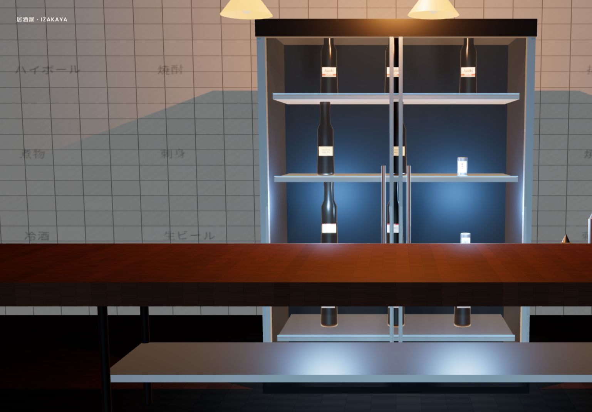
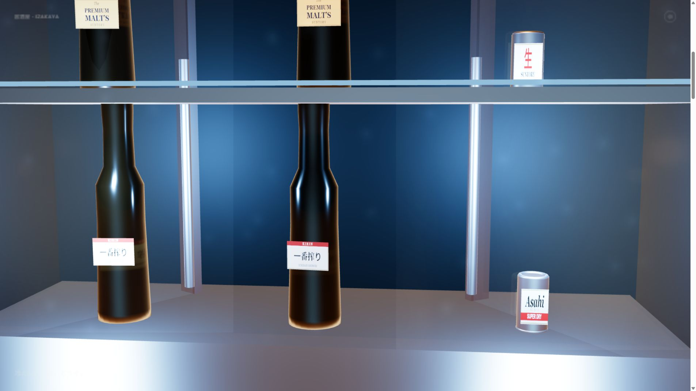
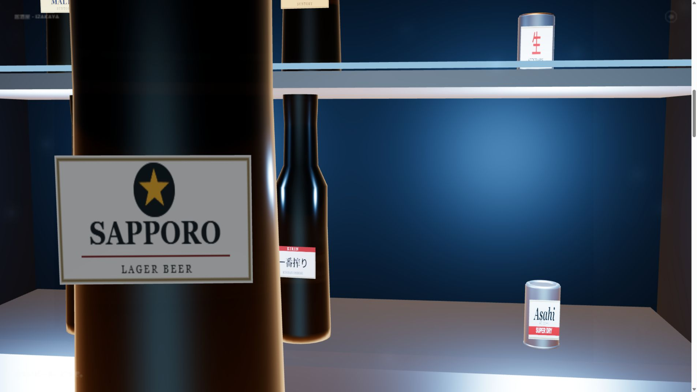
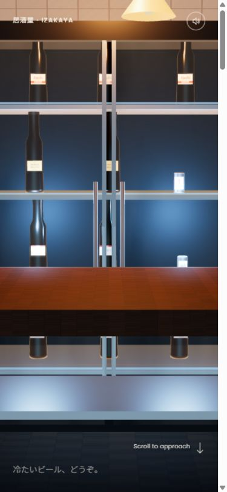

<div align="center">

# 🍺 居酒屋 · IZAKAYA

**一盏暖灯，一柜冰啤，一段由你滚动开启的居酒屋之夜。**

[](https://fengkai-jinji.github.io/izakaya-beer/)
[](https://threejs.org/)
[](https://github.com/fengkai-jinji/izakaya-beer/actions/workflows/deploy.yml)

[](https://github.com/fengkai-jinji/izakaya-beer/stargazers)
[](https://github.com/fengkai-jinji/izakaya-beer/forks)

[立即进入居酒屋](https://fengkai-jinji.github.io/izakaya-beer/) · [查看项目预览](#-项目预览) · [本地运行](#-快速开始) · [反馈建议](https://github.com/fengkai-jinji/izakaya-beer/issues)



*暖橙灯光与冰柜冷蓝，在同一间小小的居酒屋里相遇。*

</div>

## 📖 项目简介

**居酒屋 · IZAKAYA** 是一个以日式居酒屋为背景的 **3D 滚动交互体验**。白瓷砖上的日文菜单、木质吧台的纹理、玻璃门后的冷光与啤酒瓶，共同构成了这段体验的起点。

向下滚动，镜头逐渐靠近冰柜，玻璃门缓缓打开，冷雾散开；随后，一瓶 Sapporo 啤酒从底层货架浮出，来到镜头前。拖动鼠标，还可以转动瓶身，观察标签与玻璃反光。整个过程不出现手部模型，让视线停留在空间、材质与动作本身。

> **当前版本：Phase 1「居酒屋冰柜」已上线。** 酒瓶环绕、冰水取杯、冲洗杯、倒酒与上桌属于后续规划。

## 📸 项目预览

以下均为项目实际运行截图。

<table>
  <tr>
    <td width="50%" align="center">
      
      <br><strong>🚪 靠近冰柜 · 缓缓开门</strong>
      <br><sub>相机推进、双门转动与霜雾变化随滚动展开。</sub>
    </td>
    <td width="50%" align="center">
      
      <br><strong>🍺 主角浮出 · 瓶标特写</strong>
      <br><sub>从货架到眼前，支持拖拽旋转与松手惯性。</sub>
    </td>
  </tr>
</table>

<details>
<summary><strong>📱 查看手机端预览</strong></summary>

<p align="center">
  
</p>

手机端调整了文字与控件位置；竖屏视野会呈现更紧凑的场景构图。

</details>

## ✨ 核心特性

- 🎬 **滚动驱动叙事** — 镜头、柜门、霜雾和取瓶动作由同一段滚动进度编排，支持向上滚动回看。
- 🏮 **日式居酒屋氛围** — 暖色吊灯、冷蓝冰柜、白瓷砖与日文菜单，搭配深色木质吧台。
- 🧊 **玻璃与冷雾表现** — 物理玻璃材质、程序化环境反射、动态凝霜与预分配雾气粒子。
- 🍻 **多款啤酒陈列** — 十二件瓶罐库存，程序化绘制 Sapporo、Kirin、Asahi、Suntory 等标签。
- 🖱️ **拖拽与惯性旋转** — 取瓶后解锁旋转，松手后逐渐减速，并保留轻微的待机转动。
- 🔊 **程序化音效** — Web Audio 合成开关柜、低频运行声和碰撞音效，支持静音切换。
- ⚙️ **物理与资源回退** — Rapier 固定步长模拟；缺少外部模型或环境贴图时使用程序化资产。

## 🕹️ 体验方式

| 操作 | 体验内容 |
| --- | --- |
| 向下滚动 | 靠近冰柜、打开柜门、取出主角瓶 |
| 向上滚动 | 反向回看，恢复柜门与取瓶位置 |
| 取瓶后拖拽画布 | 转动瓶身，观察标签与材质 |
| 松开鼠标或触点 | 瓶身保留惯性并逐渐减速 |
| 点击右上角声音按钮 | 开启或关闭音效 |

声音会在首次滚动、点击或其他用户操作后解锁。末段按既定相机参数呈现瓶标特写。

## 🛠️ 技术栈

| 层级 | 技术 | 用途 |
| --- | --- | --- |
| 3D 渲染 | **Three.js r169 / WebGL** | 场景、物理材质、环境反射与阴影 |
| 滚动编排 | **GSAP + ScrollTrigger** | 滚动进度与相机、场景动作同步 |
| 物理模拟 | **Rapier compat 0.14** | 刚体、碰撞事件与固定时间步长 |
| 材质与特效 | **GLSL + CanvasTexture** | 玻璃、霜雾、木纹、瓷砖和品牌标签 |
| 音频 | **Web Audio API** | 合成音效、手势解锁与静音控制 |
| 构建部署 | **Vite 5.4 + GitHub Actions + Pages** | 本地开发、生产构建与自动发布 |
| 字体 | **Poppins + Noto Sans JP** | 界面文字与日文菜单 |

项目使用原生 JavaScript ES modules，无需 React、Vue 或服务端数据库。

## 🚀 快速开始

### 环境要求

- Node.js **22**
- npm
- 支持 WebGL 的现代浏览器

### 下载并启动

```bash
git clone https://github.com/fengkai-jinji/izakaya-beer.git
cd izakaya-beer
npm ci
npm run dev
```

打开终端提示的本地地址即可体验。

### 生产构建与预览

```bash
npm run build
npm run preview
```

构建结果位于 `dist/`。本地预览服务用于检查构建产物。

## 📁 项目结构

```text
izakaya-beer/
├── .github/workflows/
│   └── deploy.yml              # GitHub Pages 自动部署
├── docs/images/                # README 实机截图
├── src/
│   ├── core/                   # 引擎、相机、滚动与顶层编排
│   ├── scenes/                 # 场景基类与 Phase 1 冰柜
│   ├── shaders/                # 玻璃、霜雾、瓷砖与木纹
│   ├── systems/                # 物理、音频与粒子系统
│   ├── ui/                     # 界面叠层与样式
│   ├── utils/                  # 资产、常量、标签与菜单绘制
│   └── main.js                 # 应用入口
├── index.html
├── vite.config.js
├── package.json
└── README.md
```

当前场景依靠程序化资产即可运行。需要替换模型或环境贴图时，可在 `public/models/`、`public/textures/` 下放入对应文件；这两个空目录不会出现在 Git 记录中。

## 🎯 场景路线

| 场景 | 内容 | 进度 |
| --- | --- | --- |
| 🚪 居酒屋冰柜 | 镜头推进、开门、冷雾与取瓶 | ✅ 已上线 |
| 🍺 酒瓶 360° | 广告式环绕与瓶身观察 | 📋 规划中 |
| 🧊 冰水取杯 | 冰槽、冰块、水面与水花 | 📋 规划中 |
| 💦 冲洗杯 | 倒扣按压、喷水与杯壁水流 | 📋 规划中 |
| 🍻 精酿倒酒 | 龙头出酒、酒液与泡沫 | 📋 规划中 |
| 🏮 上桌 | 放上吧台、留下水渍、喝一口 | 📋 规划中 |

## 🌐 在线部署

**体验地址：** [fengkai-jinji.github.io/izakaya-beer](https://fengkai-jinji.github.io/izakaya-beer/)

向 `main` 分支提交更新后，GitHub Actions 会安装依赖、构建并发布到 GitHub Pages。工作流通过 `VITE_BASE_PATH=/izakaya-beer/` 适配站点子目录；本地开发仍使用根路径。

部署配置位于 [deploy.yml](.github/workflows/deploy.yml)。在仓库 **Settings → Pages** 中，发布来源应选择 **GitHub Actions**。

<details>
<summary><strong>🔧 开发与素材说明</strong></summary>

- Three.js 的 Rapier 适配器在构建时接入本地 WASM 包，共用一个由项目控制的物理世界；升级 Three.js 时需同步检查适配逻辑。
- 当前采用程序化模型、贴图与声音，画面不依赖额外下载的 GLB 或录音。
- 固定的 Vite 5 开发工具链存在已知审计提示，本地开发服务保持绑定 localhost；升级工具链时应重新验证兼容性。
- 标签中的品牌名用于识别场景内产品，本项目与相关品牌无隶属关系。

</details>

## 🤝 参与项目

欢迎通过 [Issues](https://github.com/fengkai-jinji/izakaya-beer/issues) 提交问题、分享体验或提出建议。改进场景效果、交互细节和项目文档，也可以通过 Pull Request 参与。

1. Fork 本仓库。
2. 创建分支：`git checkout -b feature/your-idea`。
3. 完成修改并验证本地运行与构建。
4. 提交 Pull Request，说明改动内容；涉及画面时附上截图。

## 💬 联系与反馈

- **项目维护者：** [fengkai-jinji](https://github.com/fengkai-jinji)
- **问题反馈：** [GitHub Issues](https://github.com/fengkai-jinji/izakaya-beer/issues)
- **在线体验：** [进入居酒屋](https://fengkai-jinji.github.io/izakaya-beer/)

---

<div align="center">

> 暖灯留住夜色，冷雾包裹瓶身。  
> 向下滚动，让这一杯故事慢慢开始。

**居酒屋 · IZAKAYA — 把居酒屋的片刻，带到屏幕前。**

⭐ 如果你喜欢这段体验，欢迎为项目点亮一颗星。

</div>
